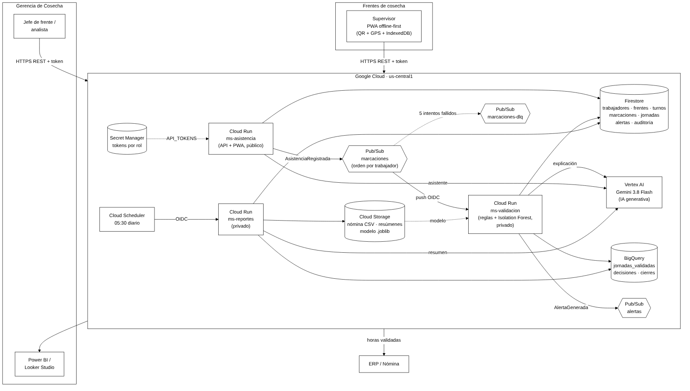

# Turnos Cosecha · Gestión y validación inteligente de turnos y asistencia en Google Cloud

Proyecto final de **Computación en la Nube** · Maestría en Inteligencia Artificial y Ciencia de Datos · Universidad Autónoma de Occidente (UAO), 2026
Estudiante: **José Omar Vidal Mera** · Docente: **Ing. Juan Guillermo Gómez Torres**

Esta plataforma serverless captura en campo los turnos y la asistencia del personal de la Gerencia de Cosecha del Ingenio del Cauca S.A.S. Cada marcación se valida de forma automática con reglas de negocio y con un modelo de detección de anomalías. Gemini, en Vertex AI, explica en lenguaje natural las jornadas observadas, redacta el resumen diario y responde preguntas sobre los indicadores del día.

> Todos los datos del repositorio son **sintéticos**. No contiene información real de trabajadores (Ley 1581 de 2012).

**Documento del proyecto:** [docs/documento-proyecto.md](docs/documento-proyecto.md) (versión Word en `docs/`) · **Decisiones de arquitectura:** [docs/adr/](docs/adr/README.md)

## Arquitectura



| # | Servicio de Google Cloud | Uso |
|---|---|---|
| 1 | **Cloud Run** | 3 microservicios: `ms-asistencia` (API + PWA, público), `ms-validacion` y `ms-reportes` (privados) |
| 2 | **Pub/Sub** | Eventos `AsistenciaRegistrada` (orden por trabajador, reintentos, dead-letter) y `AlertaGenerada` |
| 3 | **Firestore** | Datos operativos y auditoría |
| 4 | **BigQuery** | Histórico analítico (Power BI / Looker Studio) |
| 5 | **Cloud Storage** | Archivo diario de horas validadas para nómina, resúmenes y modelo |
| 6 | **Cloud Scheduler** | Cierre diario a las 05:30 (hora Colombia) |
| 7 | **Vertex AI – Gemini 3.8 Flash** | **IA generativa**: explicaciones, resumen diario y asistente |
| + | Secret Manager, Artifact Registry, Cloud Build, IAM, Cloud Logging y Monitoring | Seguridad, CI/CD y observabilidad |

Flujo: el supervisor registra la marcación en la PWA (aunque no haya señal) → `ms-asistencia` la guarda de forma idempotente y publica el evento → Pub/Sub lo entrega a `ms-validacion` → reglas e Isolation Forest → si hay hallazgos, Gemini explica y se genera una alerta → el jefe de frente aprueba o rechaza → `ms-reportes` produce el archivo de nómina y el resumen.

## Probarlo en local (sin Google Cloud)

```bash
python -m venv .venv && source .venv/bin/activate
pip install -r requirements-dev.txt
python -m scripts.run_local --simular
```

Abra http://localhost:8080/app/ con alguno de estos tokens:

| Token | Rol | Qué puede hacer |
|---|---|---|
| `demo-supervisor` | Supervisor | Registrar marcaciones |
| `demo-jefe` | Jefe de frente | Aprobar o rechazar jornadas observadas, consultar alertas, usar el asistente |
| `demo-analista` | Analista | Consultar indicadores y usar el asistente |

`--simular` carga dos días con siete casos atípicos. Para verlos, consulte la fecha de **ayer** en *Jornadas*, *Alertas* e *Indicadores e IA*. En modo local, Firestore se reemplaza por memoria, Pub/Sub por un bus en el mismo proceso y Gemini por plantillas. BigQuery y Cloud Storage se escriben en `.datos_locales/`. La API se documenta sola en http://localhost:8080/docs.

```bash
python -m pytest -q   # 19 pruebas: reglas, modelo y flujo de punta a punta
ruff check .
```

## Despliegue en Google Cloud

Requisitos: un proyecto con facturación activa. Todos los pasos se ejecutan en **Cloud Shell**, que ya trae gcloud, bq, Python y Docker.

```bash
git clone https://github.com/jovidal243/cosecha-turnos-gcp.git && cd cosecha-turnos-gcp
cp infra/variables.env.example infra/variables.env   # edite PROJECT_ID (y BILLING_ACCOUNT si desea el presupuesto)
bash infra/01_aprovisionar.sh      # APIs, Firestore, Pub/Sub, BigQuery, bucket, cuentas de servicio, secreto, presupuesto
bash infra/02_desplegar.sh         # Cloud Build: pruebas → 3 imágenes → Cloud Run
bash infra/03_conectar_eventos.sh  # suscripción push OIDC, Cloud Scheduler y datos sintéticos
bash infra/04_demo.sh              # simula dos días y ejecuta el cierre diario
```

Los tokens de acceso quedan en `infra/tokens.local.txt` (no se versiona). Al terminar la sustentación, ejecute `bash infra/99_eliminar.sh` para no generar costos.

**CD desde GitHub (opcional):** en Cloud Build → Activadores, conecte este repositorio con la configuración `cloudbuild.yaml`, la cuenta de servicio `sa-cloudbuild` y las sustituciones `_BUCKET` y `_TAG=$SHORT_SHA`.

## Estructura

```
common/                  dominio compartido: config, repositorio (Firestore/memoria), eventos (Pub/Sub/local),
                         BigQuery, Cloud Storage, Gemini, autenticación, auditoría, indicadores, datos sintéticos
services/
  ms_asistencia/         API FastAPI + PWA offline-first (static/)
  ms_validacion/         reglas.py, anomalias.py (Isolation Forest), procesador.py
  ms_reportes/           cierre diario: CSV para nómina + resumen con Gemini
ml/                      datos sintéticos y entrenamiento del Isolation Forest
scripts/                 run_local, simular_dia, cargar_semilla, construir_documento
infra/                   scripts gcloud idempotentes, esquemas y vista de BigQuery
tests/                   pruebas unitarias y de punta a punta
docs/                    documento del proyecto, ADR, diagramas (Mermaid + PNG), capturas
Dockerfile               imagen única parametrizada por servicio (--build-arg SERVICIO=...)
cloudbuild.yaml          CI/CD en Google Cloud
.github/workflows/ci.yml lint + pruebas + construcción de imágenes en cada push
```

## Reglas de validación

| Código | Regla | Severidad |
|---|---|---|
| R01 | Jornada > 10 h | Observación |
| R02 | Descanso < 8 h entre jornadas (turno continuo) | Observación |
| R03 | Entrada con jornada abierta (traslape) | Rechazo |
| R04 | Horas extra por encima de las autorizadas | Observación |
| R05 | Fuera de la geocerca del frente | Observación |
| R06 | Salida sin entrada | Rechazo |
| R07 | Duración inválida | Rechazo |
| R08 | Patrón atípico (Isolation Forest) | Observación |
| R09 | Sin turno programado | Observación |
| R10 | Trabajador no registrado | Rechazo |

## Costos

Estimación para el piloto: **≈ USD 4 a 8 al mes**. Casi todo cabe en la capa gratuita y el costo principal es Gemini. Ver la sección 8 del documento.

## Regenerar la documentación

```bash
python docs/adr/adrs.py                       # ADR individuales desde la fuente única
for f in docs/diagramas/*.mmd; do mmdc -c docs/diagramas/mermaid-config.json -b white -s 2 -i $f -o ${f%.mmd}.png; done
python -m scripts.construir_documento         # documento-proyecto.md + .docx en blanco y negro
```
